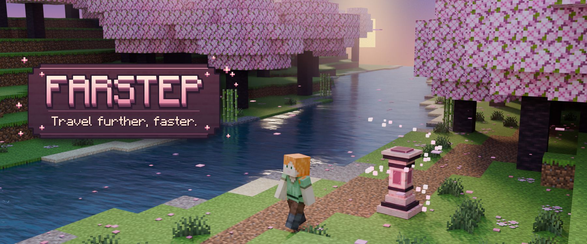
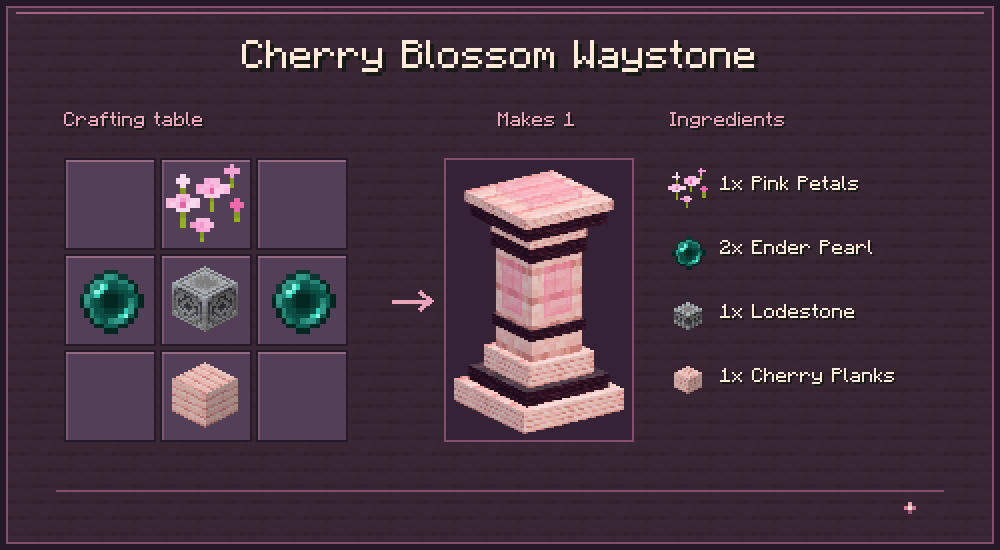
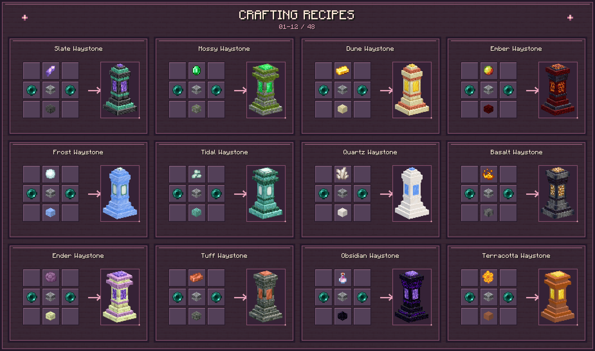
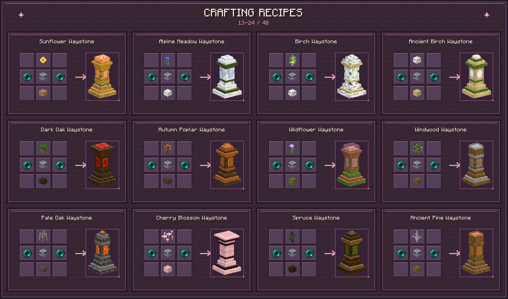
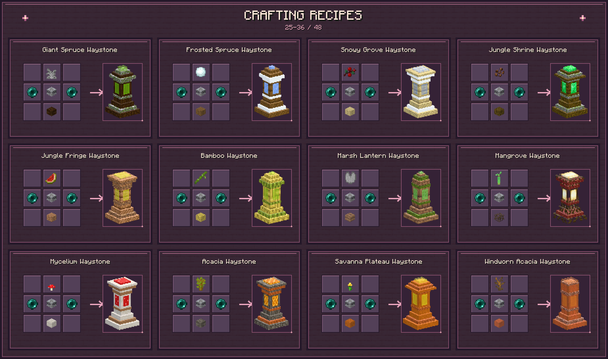
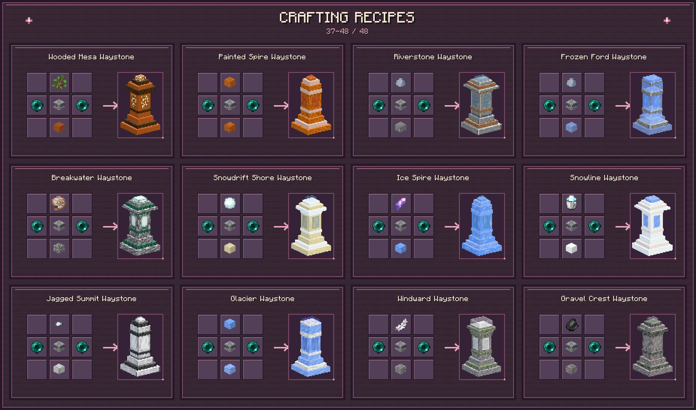
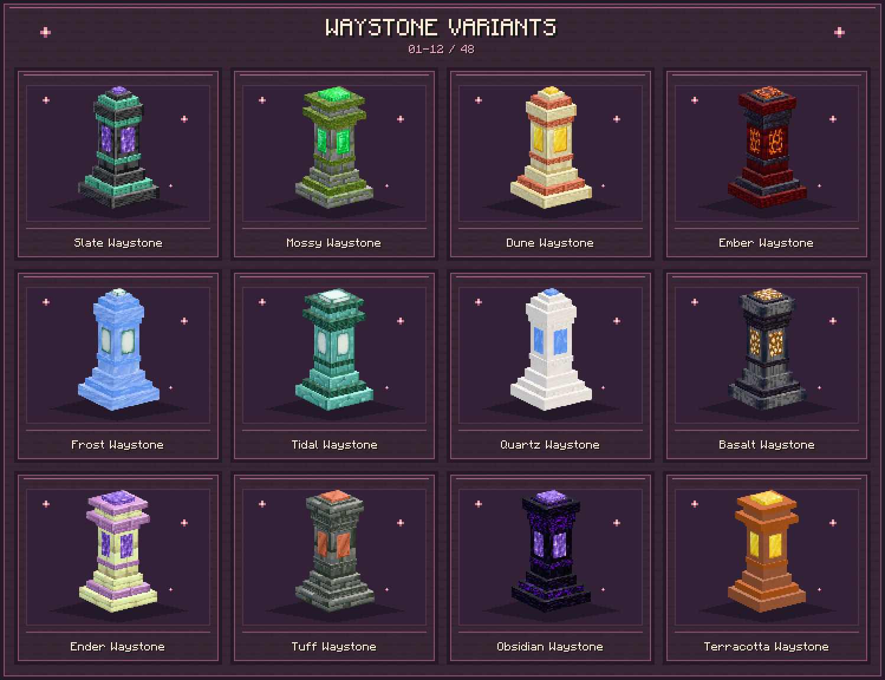
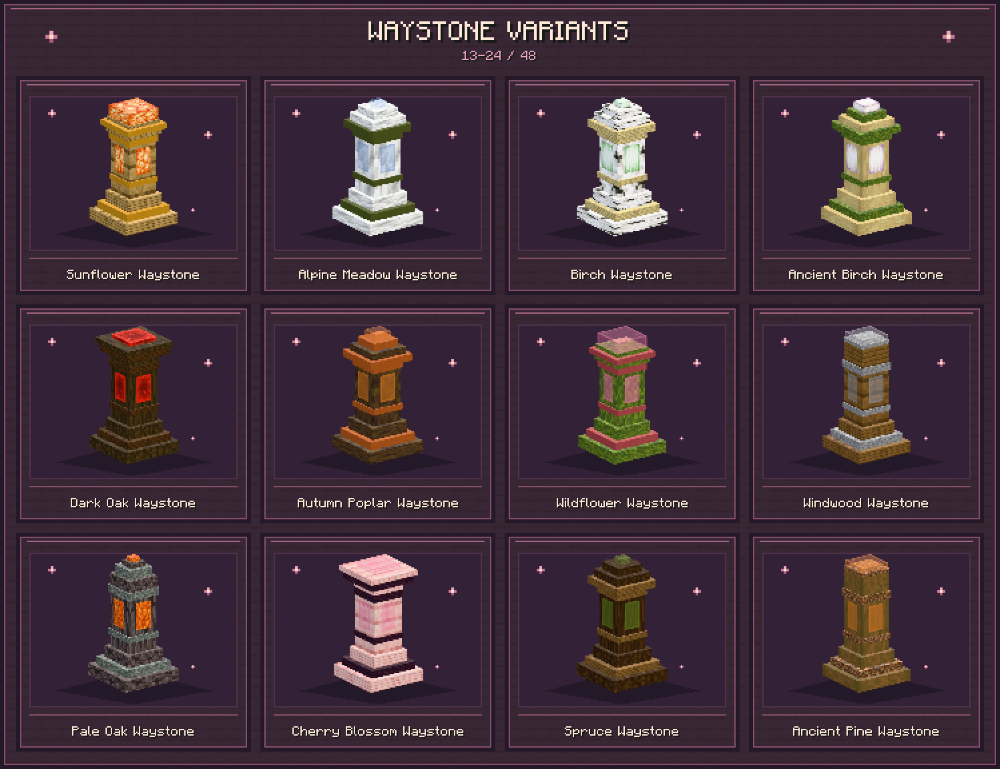
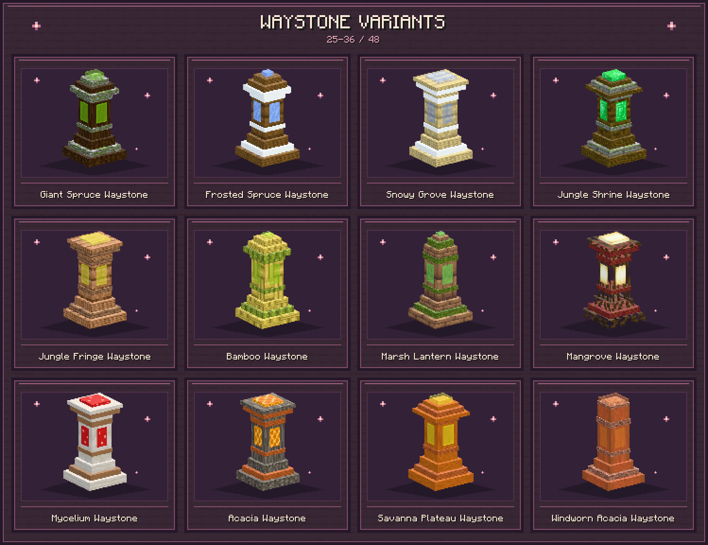
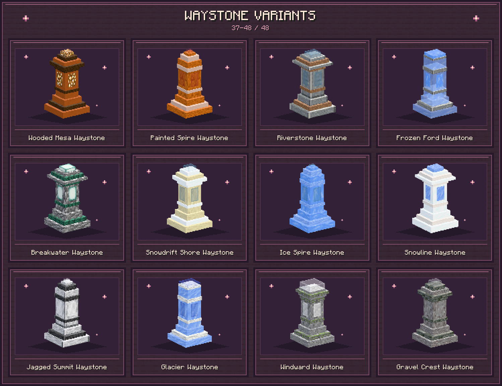

# Farstep

**Farstep 1.0.0** is a vanilla Minecraft Java 26.3 datapack for linking places with waystones. The datapack runs the network. The resource pack supplies the models, menu artwork and English and French text.

## Install and make your first trip

1. Place the [Farstep 1.0.0 Datapack](./Farstep-1.0.0-Datapack) folder or ZIP in your world's `datapacks` folder.
2. Enable [Farstep 1.0.0 Resource Pack](./Farstep-1.0.0-Resource-Pack) in each player's client.
3. Restart the server or reopen the world. Place two stones in the Overworld, then right-click one and pick the other.

If installing a ZIP, open it once to check that `pack.mcmeta` sits at the root, alongside `data/` or `assets/`.

## Crafting

Pick up a lodestone to unlock the recipes. All 48 recipes use the same shape. Put the lodestone between two ender pearls, with the two style ingredients directly above and below it.

Browse all 48 recipes

Browse all 48 models

## Player controls

| Input | Action |
| --- | --- |
| Right-click | Open the travel menu. |
| Crouch and right-click | Rename a stone you own. |
| Manage stone | Change your stone between public and private. |
| Hit a stone with a pickaxe | Recover it, subject to ownership settings. |

## Server settings

Run `/function farstep:config` as an operator. New installations default to free travel, natural discoveries enabled and private-stone protection enabled.

| Fare | What it charges |
| --- | --- |
| Free | No charge. |
| Fixed XP | A set number of points, for example 50 XP. |
| Fixed levels | A set number of levels, for example 1 level. |
| Distance in points or levels | One point or level per started interval, rounded up. |

Distance is measured horizontally. At one point per 500 blocks, a 501-block trip costs two points. Farstep charges only after a successful teleport.

When natural discoveries are on, 43 styles can appear during exploration. The network supports up to 64 registered stones. Use `/function farstep:give_all` to get one of every style for testing.

## Compatibility and removal

Pick up placed stones before uninstalling so their collision blocks are removed.

Farstep supplies item-model and loot-table overrides for daylight detectors and lecterns. Another pack overriding those same files can conflict depending on pack order.

## License

[MIT](./LICENSE) covers Farstep's own work. Minecraft textures and characters belong to Mojang and Microsoft.
